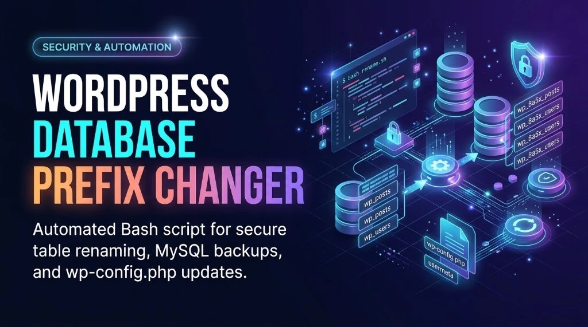

# WP Change Prefix

Readme: [EN](README.md)

 



Um script Bash poderoso, seguro e automatizado para alterar o prefixo das tabelas do banco de dados do WordPress. Esta ferramenta gerencia todo o processo: criação de backup do banco de dados, renomeação das tabelas, atualização de referências internas (usermeta/options) e modificação do `wp-config.php`.

## Recursos

- **Descoberta Automática**: Detecta automaticamente as credenciais do banco de dados e o prefixo atual a partir do wp-config.php.
- **Segurança em Primeiro Lugar**: Cria um backup completo do banco de dados (`.sql dump`) antes de aplicar qualquer alteração.
- **Limpeza Profunda**: Não apenas renomeia as tabelas, mas também atualiza linhas críticas nas tabelas `_usermeta` e `_options` para evitar problemas de permissão.
- **Atualização de Configuração**: Atualiza automaticamente a variável `$table_prefix` no seu arquivo `wp-config.php`.
- **Autoatualização**: Verifica remotamente a versão mais recente do script.

## Pré-requisitos

Para executar este script, seu ambiente deve ter:
- SO Linux/Unix (Ubuntu, Debian, CentOS, etc.)
- `bash` (shell)
- `mysql` e `mysqldump` (ferramentas cliente)
- `grep`, `awk`
- `curl` ou `wget` (para verificação de atualizações)
- Acesso `Root/Sudo` é recomendado se as permissões de arquivo forem restritas, embora não seja estritamente necessário se o usuário for proprietário dos arquivos.

## Instalação

### Modo hospedado

1. **Baixe o arquivo para seu servidor:**

```bash
curl -O https://raw.githubusercontent.com/percioandrade/wpchangeprefix/refs/heads/main/wp-change-prefix.sh
```

2. **Adicione permissão de execução:**

```bash
chmod +x wp-change-prefix.sh
```

3. **Execute o script:**

```bash
./wp-change-prefix.sh
```

### Modo direto

```bash
bash <(curl -fsSL 'https://raw.githubusercontent.com/percioandrade/wpchangeprefix/refs/heads/main/wp-change-prefix.sh')
```

**Siga os prompts interativos:**

- O script irá verificar as credenciais.
- Ele mostrará o prefixo atual detectado.
- Ele pedirá o NOVO prefixo (apenas alfanumérico).
- Confirme a operação.

## Opções de Linha de Comando

```bash
./wp-change-prefix.sh
```

`-s`, `--skip`       Pular Backup: Executa o script sem criar um dump do banco de dados (Não recomendado).
`-n`, `--noversion`  Sem Verificação de Versão: Ignora a verificação remota de atualizações do script.
`-h`, `--help`       Exibe o menu de ajuda.
```

**Exemplo**

Prefixo das tabelas antes da modificação:

```bash
mysql -u sql_wpdomain_com -p sql_wpdomain_com -e 'show tables;'
Enter password: 
+------------------------------+
| Tables_in_sql_wpdomain_com   |
+------------------------------+
| wp_8b7fba_commentmeta        |
| wp_8b7fba_comments           |
| wp_8b7fba_links              |
| wp_8b7fba_options            |
| wp_8b7fba_postmeta           |
| wp_8b7fba_posts              |
| wp_8b7fba_term_relationships |
| wp_8b7fba_term_taxonomy      |
| wp_8b7fba_termmeta           |
| wp_8b7fba_terms              |
| wp_8b7fba_usermeta           |
| wp_8b7fba_users              |
+------------------------------+
```

Execução:

```bash
[root@evy wpdomain.com]# ./wpchange.sh 
[!] Starting...
[+] Database credentials found:
------------------------
| DB:   sql_wpdomain_com
| User: sql_wpdomain_com
| Host: localhost
------------------------
[+] Current prefix detected: 'wp_8b7fba_'
[!] Dumping database...
[+] Backup created at: /www/wwwroot/wpdomain.com/wp_8b7fba_db_backup_20260228003919.sql

Enter NEW prefix (e.g., 'newwp'): wpnew

[!] WARNING: This will change the prefix from 'wp_8b7fba_' to 'wpnew_'
Do you want to continue? (y/n): y
[+] Changing database tables...
[+] Renaming table: wp_8b7fba_commentmeta -> wpnew_commentmeta
[+] Renaming table: wp_8b7fba_comments -> wpnew_comments
[+] Renaming table: wp_8b7fba_links -> wpnew_links
[+] Renaming table: wp_8b7fba_options -> wpnew_options
[+] Renaming table: wp_8b7fba_postmeta -> wpnew_postmeta
[+] Renaming table: wp_8b7fba_posts -> wpnew_posts
[+] Renaming table: wp_8b7fba_term_relationships -> wpnew_term_relationships
[+] Renaming table: wp_8b7fba_term_taxonomy -> wpnew_term_taxonomy
[+] Renaming table: wp_8b7fba_termmeta -> wpnew_termmeta
[+] Renaming table: wp_8b7fba_terms -> wpnew_terms
[+] Renaming table: wp_8b7fba_usermeta -> wpnew_usermeta
[+] Renaming table: wp_8b7fba_users -> wpnew_users
[+] Updating internal rows (usermeta/options)...
[+] Updating $table_prefix variable in wp-config.php...
[+] Updating $table_prefix variable in wp-config.php...
--------------------------------------------------------
[+] Process completed successfully!
[+] Novo Prefixo: wpnew_
[+] Database: sql_wpdomain_com
--------------------------------------------------------
```

Prefixo depois da execução:

```bash
mysql -u sql_wpdomain_com -p sql_wpdomain_com -e 'show tables;'
Enter password: 
+----------------------------+
| Tables_in_sql_wpdomain_com |
+----------------------------+
| wpnew_commentmeta          |
| wpnew_comments             |
| wpnew_links                |
| wpnew_options              |
| wpnew_postmeta             |
| wpnew_posts                |
| wpnew_term_relationships   |
| wpnew_term_taxonomy        |
| wpnew_termmeta             |
| wpnew_terms                |
| wpnew_usermeta             |
| wpnew_users                |
+----------------------------+
```

## Como Funciona

- **Validação**: Verifica se o `wp-config.php` existe e analisa as credenciais do banco de dados.
- **Conexão**: Testa a conexão com o servidor MySQL.
- **Detecção**: Examina `information_schema` para encontrar o prefixo ativo (procurando por `_usermeta` ou `_options`).
- **Backup**: Executa `mysqldump` para salvar o estado atual.
- **Renomeação**: Percorre todas as tabelas que correspondem ao prefixo antigo e as renomeia para o novo prefixo.
- **Correção de Dados**: Executa atualizações SQL para corrigir referências de prefixo dentro de `usermeta` (chaves como `wp_capabilities`) e options (chaves `like wp_user_roles`).
- **Finalização**: Atualiza a variável PHP no arquivo de configuração.

## Aviso Legal

> [!WARNING]
> Este software é fornecido "tal como está". Certifique-se sempre de ter permissão explícita antes de executar. O autor não se responsabiliza por qualquer uso indevido, consequências legais ou impacto nos dados causados ​​por esta ferramenta.

## Detailed Tutorial

Para um guia completo, passo a passo, confira meu artigo completo:

👉 [**Mudar prefixo do banco de dados WordPress**](https://perciocastelo.com.br/blog/change-wordpress-database-prefix.html)

## Licença

Este projeto está licenciado sob a **GNU General Public License v3.0**. Veja o arquivo [LICENSE](LICENSE) para mais detalhes.