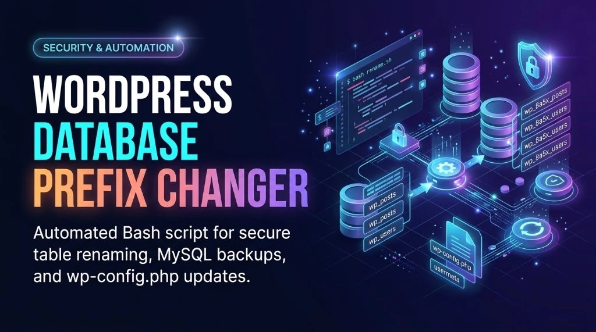

# WordPress Database Prefix Changer

Readme: [PT-BR](README-ptbr.md)

[](LICENSE)
[](https://github.com/sr00t3d/wpchangeprefix/releases)
[](https://www.gnu.org/software/bash/)



**WordPress Database Prefix Changer v2.0.0** is a Bash CLI utility that hardens WordPress installations by renaming all MySQL/MariaDB tables from the default `wp_` prefix to a custom or randomly generated prefix, patching internal `options` and `usermeta` references, updating `$table_prefix` in `wp-config.php`, and creating `chmod 600` backups automatically.

---

## Features

- **Zero Password Exposure in Process List**: authenticates to `mysql` and `mysqldump` via a temporary `chmod 600` `--defaults-extra-file` (safely quoting passwords containing `#` or `;`) cleaned up automatically via `trap`
- **Automatic Backups (`chmod 600`)**: creates both a `--single-transaction` SQL dump and a timestamped `wp-config.php.bak.*` before renaming any table
- **Complete Internal Patching**: updates `*_user_roles` in `options` and all prefix-scoped keys (`*_capabilities`, `*_user_level`, `*_user-settings`, etc.) in `usermeta`
- **Random Prefix Generator (`--random`)**: generates cryptographically random prefixes (`wp_<6hex>_`) from `/dev/urandom`
- **Dry-Run Simulation (`--dry-run`)**: previews every table rename without modifying the database or `wp-config.php`
- **Multi-Format Reporting (`-o table|json|csv`)**: ASCII table, JSON for pipelines, or CSV for audit trails
- **Strict Prefix Validation**: rejects invalid characters or identical prefixes before running any SQL

---

## Requirements

- Linux with Bash 4+
- `mysql` and `mysqldump` client binaries
- Read/write access to `wp-config.php` and `ALTER`/`UPDATE` privileges on the WordPress database

---

## Installation

```bash
curl -fsSLO https://raw.githubusercontent.com/sr00t3d/wpchangeprefix/main/wp-change-prefix.sh
chmod +x wp-change-prefix.sh
```

---

## Usage

```bash
./wp-change-prefix.sh [OPTIONS]

Options:
  -c, --config PATH       Path to wp-config.php (default: ./wp-config.php)
  -p, --new-prefix STR    New table prefix (alphanumeric/underscore, e.g. wp_sec9_)
  --random                Auto-generate a random prefix (format: wp_<6hex>_)
  -b, --backup-dir DIR    Directory to save SQL dump and wp-config.php backup
  -s, --skip-backup       Skip creating SQL dump and wp-config.php backup
  -y, --yes               Skip interactive confirmation prompt
  --dry-run               Preview tables and changes without modifying DB or files
  -o, --output FORMAT     Output format: table (default), json, csv
  -q, --quiet             Suppress standard output (errors still go to stderr)
  --no-color              Disable ANSI colors
  -V, --version           Show version and exit
  -h, --help              Show this help and exit
```

### Examples

```bash
# Preview table renames without making any changes
./wp-change-prefix.sh -c /var/www/html/wp-config.php -p wp_sec9_ --dry-run

# Rename tables with automatic SQL and wp-config.php backups
./wp-change-prefix.sh -c /var/www/html/wp-config.php -p wp_sec9_ --yes

# Auto-generate a random prefix and output JSON
./wp-change-prefix.sh -c /var/www/html/wp-config.php --random --yes -b /root/wp-backups -o json

# Non-interactive CSV audit output
./wp-change-prefix.sh -c /var/www/html/wp-config.php -p wp_prod_ --yes -o csv
```

---

## Real Output Example

Captured live on an AlmaLinux 8.10 cPanel/WHM server with MariaDB:

### Table output (default)

```text
$ ./wp-change-prefix.sh -c /tmp/wp-prefix-e2e/wp-config.php -p wp_sec9_ --yes --no-color

WordPress Database Prefix Changer v2.0.0
Config     : /tmp/wp-prefix-e2e/wp-config.php
Database   : wp_prefix_e2e (localhost)
Prefix     : wp_ -> wp_sec9_
SQL Backup : /tmp/wp-prefix-e2e/wp_prefix_e2e_wp_backup_20261120_054308.sql
Cfg Backup : /tmp/wp-prefix-e2e/wp-config.php.bak.20261120_054308
Dry-Run    : no
Status     : SUCCESS
Timestamp  : 2026-11-20T05:43:08Z

+------------------------------+------------------------------+--------------+
| Old Table                    | New Table                    | Status       |
+------------------------------+------------------------------+--------------+
| wp_options                   | wp_sec9_options              | RENAMED      |
| wp_postmeta                  | wp_sec9_postmeta             | RENAMED      |
| wp_posts                     | wp_sec9_posts                | RENAMED      |
| wp_usermeta                  | wp_sec9_usermeta             | RENAMED      |
| wp_users                     | wp_sec9_users                | RENAMED      |
+------------------------------+------------------------------+--------------+
Summary    : 5 tables | options patched: 1 | usermeta patched: 3 | wp-config updated: true
```

### Dry-run simulation (`--dry-run`)

```text
$ ./wp-change-prefix.sh -c /tmp/wp-prefix-e2e/wp-config.php -p wp_sec9_ --dry-run --no-color

WordPress Database Prefix Changer v2.0.0
Config     : /tmp/wp-prefix-e2e/wp-config.php
Database   : wp_prefix_e2e (localhost)
Prefix     : wp_ -> wp_sec9_
SQL Backup : none
Cfg Backup : none
Dry-Run    : yes
Status     : DRY_RUN
Timestamp  : 2026-11-20T05:43:08Z

+------------------------------+------------------------------+--------------+
| Old Table                    | New Table                    | Status       |
+------------------------------+------------------------------+--------------+
| wp_options                   | wp_sec9_options              | WOULD_RENAME |
| wp_postmeta                  | wp_sec9_postmeta             | WOULD_RENAME |
| wp_posts                     | wp_sec9_posts                | WOULD_RENAME |
| wp_usermeta                  | wp_sec9_usermeta             | WOULD_RENAME |
| wp_users                     | wp_sec9_users                | WOULD_RENAME |
+------------------------------+------------------------------+--------------+
Summary    : 5 tables | options patched: 0 | usermeta patched: 0 | wp-config updated: false
```

### Random prefix JSON output (`--random -o json`)

```json
{
  "version": "2.0.0",
  "status": "SUCCESS",
  "config_path": "/tmp/wp-prefix-e2e/wp-config.php",
  "database": "wp_prefix_e2e",
  "old_prefix": "wp_sec9_",
  "new_prefix": "wp_aff74d_",
  "tables_count": 5,
  "options_rows_updated": 1,
  "usermeta_rows_updated": 3,
  "config_updated": true,
  "sql_backup": "none",
  "config_backup": "none",
  "dry_run": false,
  "timestamp": "2026-11-20T05:43:09Z",
  "tables": [
    {"old": "wp_sec9_options", "new": "wp_aff74d_options", "status": "RENAMED"},
    {"old": "wp_sec9_postmeta", "new": "wp_aff74d_postmeta", "status": "RENAMED"},
    {"old": "wp_sec9_posts", "new": "wp_aff74d_posts", "status": "RENAMED"},
    {"old": "wp_sec9_usermeta", "new": "wp_aff74d_usermeta", "status": "RENAMED"},
    {"old": "wp_sec9_users", "new": "wp_aff74d_users", "status": "RENAMED"}
  ]
}
```

### CSV output (`-o csv`)

```csv
timestamp,database,old_prefix,new_prefix,dry_run,old_table,new_table,status
2026-11-20T05:43:09Z,"wp_prefix_e2e","wp_aff74d_","wp_prod_",false,"wp_aff74d_options","wp_prod_options",RENAMED
2026-11-20T05:43:09Z,"wp_prefix_e2e","wp_aff74d_","wp_prod_",false,"wp_aff74d_postmeta","wp_prod_postmeta",RENAMED
2026-11-20T05:43:09Z,"wp_prefix_e2e","wp_aff74d_","wp_prod_",false,"wp_aff74d_posts","wp_prod_posts",RENAMED
2026-11-20T05:43:09Z,"wp_prefix_e2e","wp_aff74d_","wp_prod_",false,"wp_aff74d_usermeta","wp_prod_usermeta",RENAMED
2026-11-20T05:43:09Z,"wp_prefix_e2e","wp_aff74d_","wp_prod_",false,"wp_aff74d_users","wp_prod_users",RENAMED
```

---

## License

Apache-2.0. See [LICENSE](LICENSE) for details.

## Author

[Percio Castelo](https://perciocastelo.com.br)
